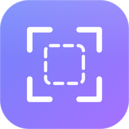

# LocalShot

<p></p>

A private, local-only **screenshot + annotation + screen-recording app for macOS**.
It lives in the menu bar, and it contains **no networking code at all** — no
telemetry, no accounts, no cloud. Your screen never leaves your Mac.

## Features

- **Capture** — region (press Space mid-drag to snap to a window), single window
  (shadow-free), or full screen (waits for the menu to close first)
- **Record** — screen recording to `.mov`; the same hotkey stops and finalizes
- **Annotate** — rectangle, ellipse, arrow, line, pen, highlighter, text,
  numbered steps, mosaic (pixelate) and blur for redactions; every mark can be
  selected, moved and resized afterwards; undo/redo; S/M/L/XL size presets
- **Recent shelf** — a Downloads-style strip in the corner with your latest
  captures: drag out as files, click to edit, Space to quick-edit the newest,
  optional auto-hide at the screen edge, pinnable on top
- **History** — gallery of the last 60 captures, auto-pruned
- **Global hotkeys** — ⌃⌘A region, ⌃⌘W window, ⌃⌘F full screen, ⌃⌘R record
  (all rebindable in Settings)
- Capture straight to clipboard, or save as PNG/JPEG/TIFF/PDF to a folder you pick;
  optional shutter sound and login-item startup

## Build

Requirements: macOS 12+ and the Xcode command line tools. Nothing else — no
dependencies, no network access at build time either.

Quick build (no sandbox, everything works):

```sh
./build.sh
open LocalShot.app
```

Xcode project (the Mac App Store track):

```sh
open LocalShot.xcodeproj      # or: xcodebuild -scheme LocalShot -configuration Release build
```

- **Debug** configuration runs *without* the sandbox, so the not-yet-migrated
  legacy paths (region capture, screen recording via `/usr/sbin/screencapture`)
  keep working during development.
- **Release** configuration enables **App Sandbox** + user-selected file access
  (`LocalShot.entitlements`) — the Mac App Store requirement. Under the sandbox,
  **Capture Window** and **Capture Full Screen** work via **ScreenCaptureKit**
  (macOS 14+); region capture and recording still need the legacy binary and are
  pending migration, so don't ship a sandboxed build yet.

The first capture triggers macOS's **Screen Recording** permission prompt
(System Settings → Privacy & Security → Screen Recording → enable LocalShot,
then relaunch). That's macOS gating screen access — the app itself never makes
a network request.

## Privacy

There is no networking code in the source at all — verify it yourself:

```sh
grep -niE 'URLSession|NSURLConnection|Socket|CFStream|http|fetch' LocalShot.swift
```

No matches. (The only `http` string in this repo is the XML doctype inside
`build.sh`'s plist boilerplate — a schema identifier, not a request.)

## Project layout

- `LocalShot.swift` — the whole app: a single-file Swift/AppKit program
- `main.swift` — the executable entry point (works for both swiftc and Xcode)
- `build.sh` — compiles it into `LocalShot.app` (ad-hoc signed, no sandbox)
- `LocalShot.xcodeproj` + `LocalShot.entitlements` — the Mac App Store track;
  Debug = unsandboxed (legacy paths still work), Release = App Sandbox
- `make_icon.swift` — the app icon, drawn in pure CoreGraphics; `AppIcon.icns`
  is the generated artifact used by the build

## License

MIT — see [LICENSE](LICENSE).
