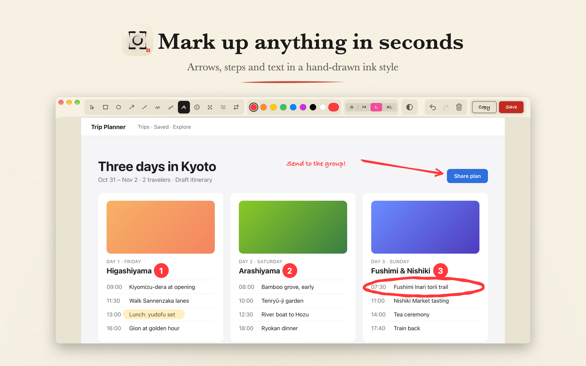
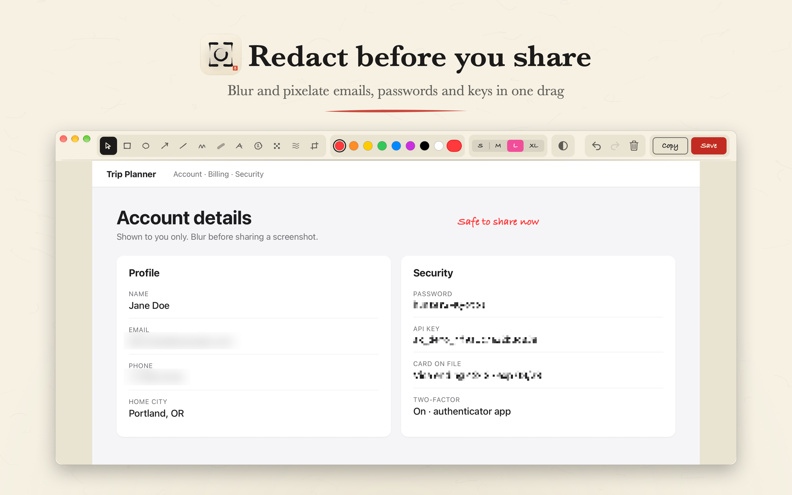
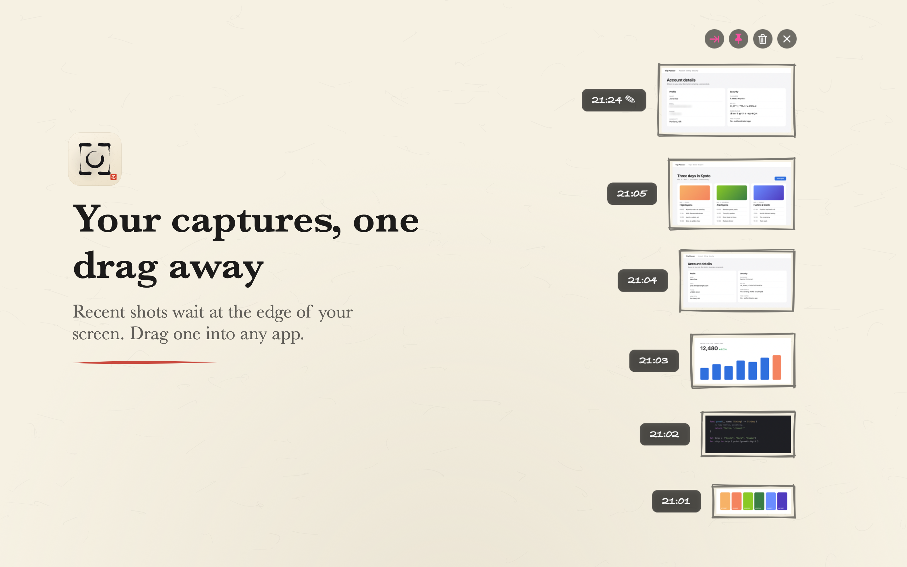
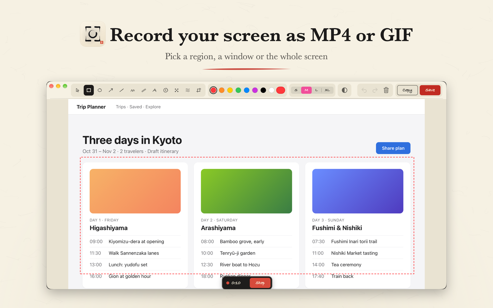

# Inkshot

<p></p>

A private, local-only **screenshot + annotation + screen-recording app for macOS**.
It lives in the menu bar, and it contains **no networking code at all** — no
telemetry, no accounts, no cloud. Your screen never leaves your Mac.

## Screenshots

<p>
<a href="docs/screenshots/1-annotate.png"></a>
<a href="docs/screenshots/2-redact.png"></a>
</p>
<p>
<a href="docs/screenshots/3-shelf.png"></a>
<a href="docs/screenshots/4-record.png"></a>
</p>

## Features

- **Capture** — region (captured as soon as you release the mouse; a magnifier
  shows the exact pixel under the cursor), single window (shadow-free), or full
  screen (waits for the menu to close first). Esc or right-click cancels
- **Record** — a region (adjustable after the drag: handles, move, arrow keys
  with ⇧ for 10 pt and ⌥ to resize, Return to confirm), a whole screen (click)
  or a window (Space), after a 3 s countdown; saves as MP4, MOV or GIF. Stop it
  with the floating Stop button, the menu, or the same hotkey
- **Annotate** — rectangle, ellipse, arrow, line, pen, highlighter, text,
  numbered steps, mosaic (pixelate) and blur for redactions, and crop; a grayscale
  button takes the color out of the capture so your colored marks stand out; every mark can be
  selected, moved and resized afterwards; undo/redo; S/M/L/XL size presets.
  Shapes render in a **hand-drawn, sketchy style** (à la Excalidraw) with a
  handwriting font for text
- **Recent shelf** — a Downloads-style strip in the corner with your latest
  captures: drag out as files, click to edit, Space to quick-edit the newest,
  optional auto-hide at the screen edge, pinnable on top
- **History** — gallery of the last 60 captures, auto-pruned
- **Global hotkeys** — ⌥⌘A region, ⌥⌘W window, ⌥⌘F full screen, ⌥⌘R record
  (all rebindable in Settings)
- Capture straight to clipboard, or save as PNG/JPEG/TIFF/PDF to a folder you pick;
  optional shutter sound and login-item startup

## Install

- **Homebrew:** `brew install --cask amoswzw/tap/inkshot`
- **Mac App Store:** coming soon
- **From source:** see Build below

The Homebrew and GitHub builds are signed with Developer ID and notarized by Apple.

## Build

Requirements: **macOS 14+** (all capture and recording use ScreenCaptureKit) and
the Xcode command line tools. Nothing else — no dependencies, and no network
access at build time either.

Quick build (no sandbox, everything works):

```sh
./build.sh
open Inkshot.app
```

`build.sh` signs with your **Apple Development** certificate if one is in your
keychain, so the Screen Recording permission survives rebuilds. Without one it
falls back to an **ad-hoc** signature: macOS then asks for the permission again
after every rebuild, and a downloaded copy is blocked by Gatekeeper as an
"unidentified developer" (right-click → **Open** once to allow it).

Xcode project (the Mac App Store track):

```sh
open Inkshot.xcodeproj      # or: xcodebuild -scheme Inkshot -configuration Release build
```

- **Debug** configuration runs *without* the sandbox.
- **Release** configuration enables **App Sandbox** + user-selected file access
  (`Inkshot.entitlements`) — the Mac App Store requirement. Every capture mode and
  screen recording go through **ScreenCaptureKit**, so they work under the sandbox;
  no external tools are launched.

The first capture triggers macOS's **Screen Recording** permission prompt
(System Settings → Privacy & Security → Screen Recording → enable Inkshot,
then relaunch). That's macOS gating screen access — the app itself never makes
a network request.

## Privacy

There is no networking code in the source at all — verify it yourself:

```sh
grep -niE 'URLSession|NSURLConnection|Socket|CFStream|http|fetch' Inkshot.swift
```

No matches. (The only `http` strings anywhere in the repo are XML doctype
identifiers inside `Inkshot-Info.plist` / `Inkshot.entitlements` — schema URLs,
not requests.)

## Project layout

- `Inkshot.swift` — the whole app: a single-file Swift/AppKit program
- `main.swift` — the executable entry point (works for both swiftc and Xcode)
- `build.sh` — compiles it into `Inkshot.app` (Apple Development or ad-hoc signed, no sandbox)
- `Inkshot.xcodeproj` + `Inkshot.entitlements` — the Mac App Store track;
  Debug = unsandboxed, Release = App Sandbox
- `make_icon.swift` — the app icon, drawn in pure CoreGraphics; `AppIcon.icns`
  and `Assets.xcassets` are its generated artifacts
- `PrivacyInfo.xcprivacy` — Apple privacy manifest: no tracking, no data collected
- `release.sh` + `packaging/` — Developer ID build, notarization and the Homebrew cask

## Credits

- The hand-drawn rendering is an original reimplementation inspired by
  [Rough.js](https://github.com/rough-stuff/rough) (MIT) and
  [Excalidraw](https://github.com/excalidraw/excalidraw) — no code from either is
  bundled.
- Handwriting text uses whichever casual system font is available (e.g. Bradley
  Hand); no fonts are bundled.
- Capture and recording build on Apple's ScreenCaptureKit and AVFoundation.

## License

MIT — see [LICENSE](LICENSE). Copyright © 2026 Amos W.
